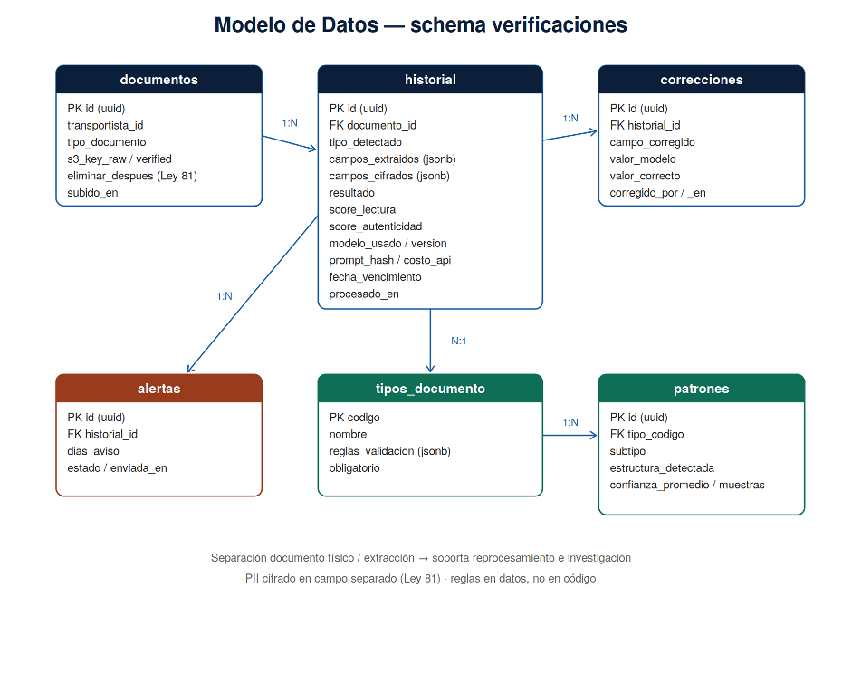

# Modelo de Datos

El modelo de datos del schema verificaciones soporta tanto la operación del sistema como su dimensión investigativa. Su diseño refleja las decisiones técnicas clave: separación del documento físico de sus extracciones, cifrado de datos personales, doble score, y reglas configurables.

## Diagrama
`docs/diagrams/ModeloDeDatos.png`

*Figura 3. Diagrama entidad-relación del schema verificaciones.*

## 4.1 Entidades y su propósito

| Entidad | Propósito |
|----------|-----------|
| documentos | Representa el documento físico subido. Guarda las claves S3 y la fecha de eliminación para la Ley 81. |
| historial | Cada fila es una extracción de un documento. Contiene los campos, los dos scores, el modelo y la versión usados, y el costo. |
| correcciones | Registra cada intervención humana como dato etiquetado: el valor del modelo frente al valor correcto. |
| tipos_documento | Cataloga los tipos con sus reglas de validación en JSONB, permitiendo ajustarlas sin cambiar código. |
| patrones | Acumula el conocimiento aprendido por tipo y variante de documento. |
| alertas | Registra las notificaciones de vencimiento enviadas, evitando duplicados. |

## 4.2 Decisiones de diseño del modelo

- Separación documento/extracción: un documento físico puede tener múltiples extracciones a lo largo del tiempo, todas apuntando al mismo registro en documentos. Esto habilita el reprocesamiento con prompts mejorados y la comparación de versiones — el corazón del valor investigativo.
- PII cifrado y separado: los datos personales sensibles se guardan en la columna campos_cifrados, separada de campos_extraidos, cifrados con KMS. Es un requisito de la Ley 81 de 2019.
- Doble score: historial guarda score_lectura y score_autenticidad de forma independiente. Un documento bien leído pero con baja autenticidad se escala a revisión manual.
- Trazabilidad: las columnas modelo_usado, version_extraccion y prompt_hash permiten saber con qué configuración se extrajo cada dato, esencial para el análisis investigativo.
- Flexibilidad con JSONB: los campos variables se guardan en JSONB porque los documentos son heterogéneos; esto se alinea con el enfoque de extracción schema-agnostic.