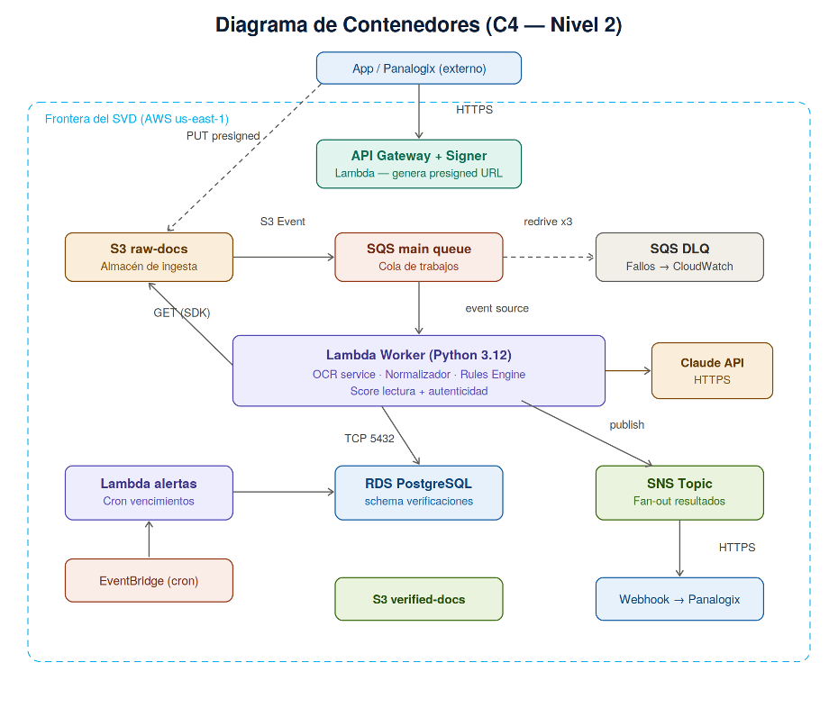

# Vista de Contenedores (C4 — Nivel 2)

La vista de contenedores abre la frontera del SVD y revela las unidades ejecutables y de almacenamiento internas, junto con los protocolos exactos que gobiernan cada comunicación. Es el nivel donde se materializa el detalle técnico de la interacción entre componentes.

## Diagrama
`docs/diagrams/VistaContenedores-diagrama.png`

*Figura 2. Diagrama de contenedores con protocolos de comunicación.*

## 3.1 Detalle de comunicación entre contenedores

Cada interacción del sistema usa un medio y un protocolo específico, elegido según la naturaleza de la comunicación:

| Origen → Destino | Medio / Protocolo | Propósito |
|------------------|-------------------|-----------|
| App → API Gateway | HTTPS (petición) | Solicitar una presigned URL de subida. |
| App → S3 raw | PUT HTTPS con URL firmada | Subir el documento directo a S3, sin pasar por el cómputo. |
| S3 raw → SQS | S3 Event Notification | Notificar la llegada de un documento nuevo. |
| SQS → Lambda Worker | Event source mapping | Invocar el worker cuando hay mensajes en la cola. |
| SQS → DLQ | Redrive policy (x3) | Aislar mensajes que fallaron tres veces. |
| Lambda → S3 raw | GET vía SDK boto3 | Descargar la imagen del documento. |
| Lambda → Claude API | HTTPS con SDK Anthropic | Extraer los campos del documento. |
| Lambda → RDS | TCP 5432 con psycopg2 | Persistir la verificación. |
| Lambda → SNS | publish vía SDK | Publicar el resultado para los suscriptores. |
| SNS → Panalogix | HTTPS POST (webhook) | Notificar el resultado de la verificación. |
| EventBridge → Lambda | Invocación programada (cron) | Disparar la revisión de vencimientos. |
| Retool → SVD | API REST | Consumir datos para el panel de gestión. |
| Grafana → CloudWatch | Consulta de métricas | Leer métricas para los dashboards. |

## 3.2 Justificación del diseño

La subida de documentos utiliza presigned URLs para que el archivo viaje directamente del dispositivo a S3, sin consumir cómputo del sistema — un patrón de descarga a servicios gestionados. La cola SQS entre S3 y el worker garantiza que ningún documento se pierda ante fallos y absorbe los picos de tráfico. La comunicación con Panalogix mediante webhook desacopla ambos sistemas: el SVD publica y se desentiende, y SNS reintenta la entrega si Panalogix no está disponible. Cada contenedor tiene una única responsabilidad y se comunica por un protocolo estándar, lo que hace el sistema mantenible y extensible.