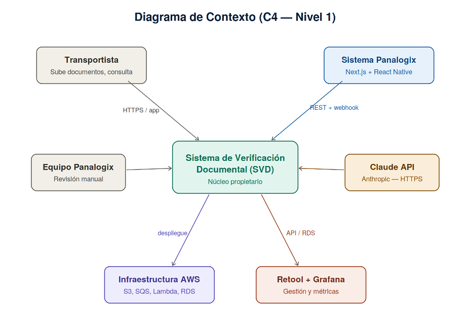

# Enfoque de documentación C4

## 1.4 Enfoque de documentación C4

La arquitectura se presenta en niveles de abstracción crecientes según el modelo C4: primero el contexto (el sistema y su entorno), luego los contenedores (las unidades ejecutables internas y sus protocolos), y finalmente el detalle de datos, comportamiento temporal y despliegue físico. Cada diagrama se acompaña de su explicación técnica y de su código fuente en formato Mermaid para reproducibilidad.

---

# Vista de Contexto (C4 — Nivel 1)

## 2. Vista de Contexto (C4 — Nivel 1)

La vista de contexto presenta el SVD como un sistema central y sus relaciones con los actores y sistemas externos. Delimita la frontera del sistema y establece qué se comunica con qué y por qué medio.

## Diagrama
`docs/diagrams/VistaContexto-diagrama.png`

## 2.1 Actores y sistemas externos

| Elemento | Rol | Medio de comunicación |
|----------|-----|-----------------------|
| Transportista | Sube documentos y consulta su estado documental. | HTTPS a través de la app de Panalogix. |
| Sistema Panalogix | Envía documentos con contexto y recibe resultados. | API REST (entrada) y webhook (salida). |
| Equipo Panalogix | Revisa manualmente los casos dudosos. | Panel de gestión (Retool) sobre API REST. |
| Claude API | Ejecuta la extracción semántica de documentos. | HTTPS con el SDK de mensajes de Anthropic. |
| Infraestructura AWS | Aloja y ejecuta todo el sistema. | Despliegue de recursos gestionados. |
| Retool + Grafana | Gestión interna y métricas. | API REST (Retool) y CloudWatch (Grafana). |

## 2.2 Decisión clave: desacoplamiento con Panalogix

La relación más importante del contexto es la que existe entre el SVD y el sistema Panalogix. La decisión arquitectónica central es que ambos sistemas no comparten base de datos. Cada uno es dueño de sus propios datos y se comunican exclusivamente por contratos explícitos: una API REST mediante la cual Panalogix envía documentos junto con el contexto de validación del transportista, y un webhook mediante el cual el SVD devuelve los resultados. Esto permite que ambos sistemas evolucionen de forma independiente y que el fallo de uno no comprometa al otro.