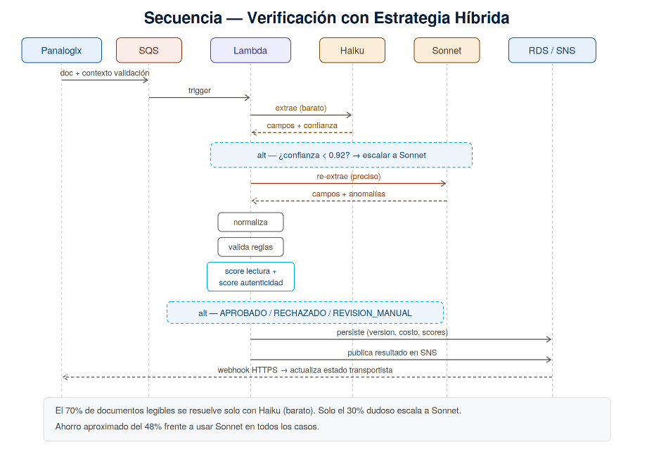

---

title: Vista de Procesos - Flujo de Verificación

document_type: Software Architecture Document (SAD)

section: 5

version: 1.0

status: Approved

project: Sistema de Verificación Documental (SVD)

product: Panalogix

author: Panalogix

last_updated: 2026-07-11

---

# Vista de Procesos — Flujo de Verificación

La vista de procesos describe la coreografía temporal del flujo principal del sistema: la verificación de un documento. Muestra el orden exacto de las interacciones, incluyendo la estrategia híbrida de modelos y el cálculo del doble score.

## Diagrama
`docs/diagrams/VistaProcesos-diagrama.png`

*Figura 4. Diagrama de secuencia del flujo de verificación híbrido.*

## 5.1 Descripción del flujo

El flujo comienza cuando Panalogix envía el documento junto con el contexto de validación del transportista — cédula, placa y nombre registrados. Esta inyección de contexto resuelve la dependencia del motor de reglas sin acoplar bases de datos. SQS dispara el worker, que aplica la estrategia híbrida: primero llama al modelo económico (Haiku) y solo escala al modelo preciso (Sonnet) si la confianza de la extracción es baja. Tras extraer, el worker normaliza los campos, aplica las reglas, y calcula los dos scores. Finalmente persiste el resultado, lo publica en SNS, y el webhook notifica a Panalogix. Si el resultado requiere revisión manual, se alerta al equipo.

## 5.2 La estrategia híbrida y su impacto

La decisión de procesar primero con Haiku y escalar a Sonnet solo cuando es necesario tiene un impacto económico directo. Asumiendo que alrededor del 70% de los documentos legibles se resuelven con el modelo económico, el ahorro frente a usar el modelo preciso en todos los casos es de aproximadamente 48%, sin sacrificar precisión en los documentos difíciles. El modelo usado en cada verificación se registra en la base de datos, lo que además alimenta el análisis investigativo sobre qué documentos requieren el modelo de mayor capacidad.